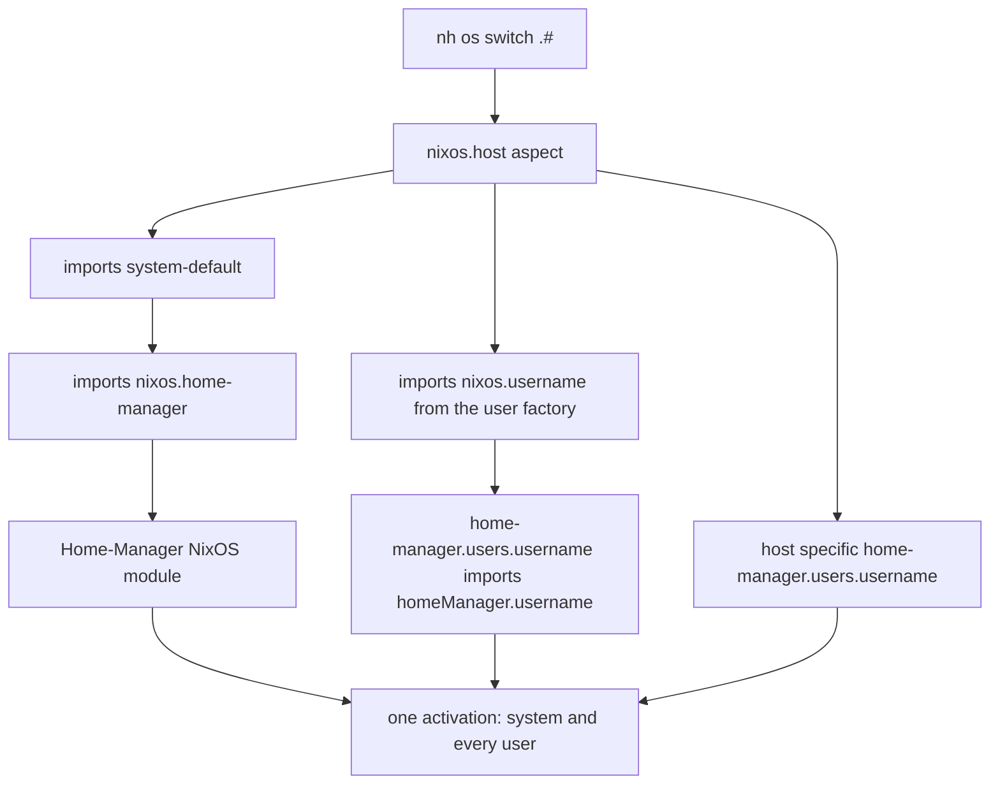

# home-manager

Wires `Home-Manager` into the `nixos` and `darwin` classes, so that you can
build your system and Home-Manager together.

It defines `flake.modules.nixos.home-manager` and
`flake.modules.darwin.home-manager`, aspects that bring the Home-Manager
NixOS/Darwin module (and shared config) into a system. `system-default`
imports them, so every host gets them.

`flake-file.nix` additionally imports the flake-parts module of Home-Manager
(`inputs.home-manager.flakeModules.home-manager`). It provides the
`homeManager` class of `flake.modules.homeManager.<aspect>`, which holds
system generic Home-Manager configuration.

To summarize, there is:
```nix
flake.modules."<nixos/darwin>"."<hostname>".home-manager.users."<username>"
```

for host specific Home-Manager changes and
```nix
flake.modules.homeManager."<username>"
```

The first is specific to `nixos` or `darwin` while the latter is generic for
both.

## How it is wired

`nh os switch` (or `darwin-rebuild switch`) builds the system and the
Home-Manager configuration of every user in one go. No separate
`home-manager switch` is needed.

1. `home-manager.nix` imports the Home-Manager NixOS/Darwin module, which
   provides the `home-manager.*` options. `useGlobalPkgs` makes Home-Manager
   use the system's `nixpkgs`, `useUserPackages` installs user packages into
   the system profile.
2. `system-default` imports this aspect, so every host gets it.
3. The `user` factory sets `home-manager.users.<username>` to import
   `homeManager.<username>`.
4. Hosts add host specific configuration through
   `home-manager.users.<username>`, e.g. `hosts/epsilon [N]/users/max.nix`.



## Configuring every user of a host

The Home-Manager NixOS/Darwin module also provides
`home-manager.sharedModules`, a list of Home-Manager modules that get added to
the configuration of every user in `home-manager.users`.

It lets a system aspect configure the Home-Manager side without knowing the
usernames of the host:

```nix
flake.modules.nixos.gaming = {
  home-manager.sharedModules = [self.modules.homeManager.mangohud];
};
```

Every user of a host importing `gaming` now gets `mangohud`. Use
`home-manager.users.<username>` instead when only one user should get it.
